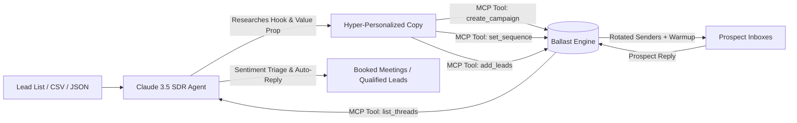

# Claude Cold Email Agent (AI SDR Starter Kit) 🤖✉️

[](https://opensource.org/licenses/MIT)
[](https://anthropic.com)
[](https://modelcontextprotocol.io)
[](https://ballast.to)

An open-source **autonomous AI Sales Development Representative (AI SDR)** built with **Anthropic Claude** and **[Ballast](https://ballast.to)** via native **Model Context Protocol (MCP)**.

It researches target B2B accounts, writes hyper-personalized 1-to-1 cold outreach sequences under 125 words, deploys them to dedicated sending infrastructure, and triages incoming replies autonomously in real time.

---

## ⚡ Why This Exists

Most teams building "AI SDRs" get blocked by existing cold email platforms:
* **Seat & mailbox limits:** Legacy tools charge \$47–\$99/month for tiny allowances, making agentic scale expensive.
* **Complex, fragile APIs:** Writing custom wrappers and webhooks for legacy dashboards requires dozens of hours.
* **Bad AI copy:** Naive GPT prompts produce cheesy, obvious AI slop ("I hope this email finds you well!").

**This starter kit solves all three:**
1. **Claude 3.5 Sonnet / Haiku Intelligence:** Enforces field-tested B2B copy frameworks (PAS, Trigger Events, Competitor Migrations, Teardowns) with strict under-125-word constraints and zero flattery.
2. **Native Ballast MCP:** Claude interacts directly with your cold email infrastructure through standardized Model Context Protocol tool calling.
3. **Affordable Infrastructure:** Powered by [Ballast](https://ballast.to) (\$19/mo for 20,000 emails, unlimited mailboxes, unlimited seats, automated warmup, and dedicated static IPs).

---

## 🛠️ Architecture



---

## 🚀 Quickstart in 3 Minutes

### 1. Clone & Install

```bash
git clone https://github.com/useballast/claude-cold-email-agent.git
cd claude-cold-email-agent
npm install
```

### 2. Configure Environment

Copy the example file and add your API keys:

```bash
cp .env.example .env
```

Edit `.env`:
```env
# 1. Anthropic API Key (from https://console.anthropic.com)
ANTHROPIC_API_KEY=sk-ant-api03-...

# 2. Ballast API Key (from https://ballast.to/dashboard -> Settings -> API Keys)
BALLAST_API_KEY=blst_live_...

# 3. Sender Identity
SENDER_NAME="Alex"
SENDER_COMPANY="Ballast"
OFFER_SUMMARY="Cold email software built for modern teams and AI agents: $19/mo for 20,000 emails."
CALENDAR_LINK="https://cal.com/your-name/15min"
```

### 3. Verify Connectivity

```bash
npm start test
```

You should see:
```text
✔ Config loaded successfully (.env).
✔ Connected to Ballast MCP! Found 28 available tools.
✔ Anthropic Claude client initialized successfully.
```

---

## 💻 Usage

### 1. Launch Autonomous Outbound Campaign

Research leads from `data/sample-leads.json`, draft personalized sequences, and enroll prospects in Ballast:

```bash
npm run outbound
```

To run against your own custom leads file:
```bash
npm run outbound -- --file ./path/to/my-leads.json --campaign "Q4 Enterprise Outbound"
```

### 2. Triage Replies (AI SDR Inbox Handling)

Inspect the Ballast Unified Inbox, classify prospect sentiment, and generate context-aware replies:

```bash
# Dry-run (inspects & drafts responses without sending)
npm run inbox

# Live mode (drafts and automatically dispatches follow-ups via Ballast Unibox)
npm run inbox -- --send
```

---

## 📋 Lead Data Format

You can pass leads as a JSON array (`data/sample-leads.json`):

```json
[
  {
    "firstName": "Sarah",
    "lastName": "Chen",
    "email": "sarah.chen@growthscale.example.com",
    "company": "GrowthScale",
    "title": "Head of Growth",
    "website": "https://growthscale.example.com",
    "notes": "Scaling B2B outbound; currently spending $240/mo across multiple tools with seat limits. Looking for programmatic sending via AI agents."
  }
]
```

---

## 🧩 Ballast MCP Tools Supported

Through `https://ballast.to/api/mcp`, Claude has access to:

| Tool | Category | What it does |
| --- | --- | --- |
| `create_campaign` | Outbound | Creates a new sequence with sending schedule and delivery rules |
| `set_sequence` | Copy & Steps | Registers multi-touch email steps, delays, subject lines, and bodies |
| `add_leads_to_campaign` | Enrollment | Enrolls researched leads with customized variables |
| `list_threads` | Unified Inbox | Fetches incoming prospect replies and conversation threads |
| `send_reply` | Inbox Triage | Sends follow-up answers or calendar booking links directly to threads |
| `get_overview` | Analytics | Monitors mailbox health, warmup status, and delivery rates |

---

## 🎯 High-Converting Pitch Principles Enforced

The agent adheres strictly to field-tested deliverability and conversion rules:
1. **Under 125 Words:** Formatted to fit on a single mobile screen without scrolling.
2. **One Verified Hook:** Anchored on tech stack, job openings, or recent company initiatives—never generic compliments.
3. **One Measurable Outcome:** Demonstrates value through concrete peer metrics (e.g. *"cut bounce rates to under 0.8% across 40k monthly sends"*).
4. **Low-Friction Ask:** Permission-based CTAs (*"Would a 2-minute breakdown be helpful?"*) rather than demanding a 30-minute demo.
5. **Clean Plain Text:** Zero images, zero tracking pixel traps, and no attachments to ensure optimal inbox placement across Google Workspace and Microsoft 365.

---

## 📄 License

Distributed under the **MIT License**. See [`LICENSE`](./LICENSE) for details.

Maintained by **[Ballast](https://ballast.to)** — The cold email platform built for modern teams and AI agents.

