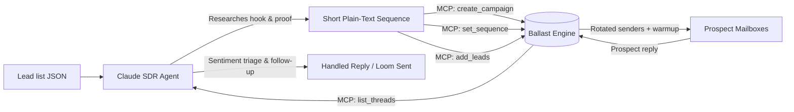

# Claude Cold Email Agent

[](https://opensource.org/licenses/MIT)
[](https://anthropic.com)
[](https://modelcontextprotocol.io)
[](https://ballast.to)

An open-source TypeScript agent that connects Anthropic's Claude to [Ballast](https://ballast.to) over the Model Context Protocol (MCP).

It reads a list of leads, writes a short three-step cold sequence for each one, schedules the campaign on Ballast, and checks the Unibox to answer incoming replies.

---

## Why this exists

Connecting an AI model to an outbound pipeline usually means writing custom REST glue and managing webhook state. Most cold email platforms also charge per connected seat or mailbox, which gets expensive as sending scales across rotated domains.

This starter template pairs Claude with Ballast over MCP:

1. **Model Context Protocol tools:** Claude creates campaigns, writes sequences, enrolls leads, and reads replies using native tool calls rather than custom API wrappers.
2. **Paced sending and deliverability controls:** Ballast sends with randomized 4-to-10 minute gaps between emails, matches Google senders to Gmail and Microsoft senders to Outlook, and pauses campaigns automatically when bounces climb.
3. **Flat volume pricing:** Ballast starts at \$19 per month for 20,000 emails with unlimited mailboxes, unlimited seats, and automated warmup on every plan.

---

## Architecture



---

## Quickstart

### 1. Clone and install

```bash
git clone https://github.com/useballast/claude-cold-email-agent.git
cd claude-cold-email-agent
npm install
```

### 2. Configure environment

Copy the example file and add your keys:

```bash
cp .env.example .env
```

Edit `.env`:
```env
# 1. Anthropic API key (from https://console.anthropic.com)
ANTHROPIC_API_KEY=sk-ant-api03-...

# 2. Ballast API key (from https://ballast.to/dashboard -> Settings -> API keys)
BALLAST_API_KEY=blst_live_...

# 3. Sender identity and asset offer
SENDER_NAME="Alex"
SENDER_COMPANY="Ballast"
OFFER_SUMMARY="Cold email software with unlimited mailboxes and native MCP: $19/mo for 20,000 emails."
VALUE_ASSET_NAME="2-minute video breakdown of how they cut delivery costs"
```

### 3. Verify connectivity

```bash
npm start test
```

Expected output:
```text
✔ Config loaded successfully (.env).
✔ Connected to Ballast MCP! Found 28 available tools.
✔ Anthropic Claude client initialized successfully.
```

---

## Usage

### 1. Run an outbound campaign

Researches leads from `data/sample-leads.json`, drafts personalized sequences, and enrolls prospects in Ballast:

```bash
npm run outbound
```

Pass a custom leads file:
```bash
npm run outbound -- --file ./path/to/my-leads.json --campaign "Q4 Enterprise Outbound"
```

### 2. Triage replies in the Unibox

Inspects the Ballast Unified Inbox, classifies reply intent (interested, objection, not interested, out of office), and prepares responses:

```bash
# Dry run: inspects threads and prints drafted replies
npm run inbox

# Live mode: dispatches answers directly to the thread
npm run inbox -- --send
```

---

## Lead data format

Leads are formatted as a JSON array (`data/sample-leads.json`):

```json
[
  {
    "firstName": "Sarah",
    "lastName": "Chen",
    "email": "sarah.chen@growthscale.example.com",
    "company": "GrowthScale",
    "title": "Head of Growth",
    "website": "https://growthscale.example.com",
    "notes": "Scaling B2B outbound; currently spending $240/mo across multiple tools with seat limits. Looking for programmatic sending via AI agents."
  }
]
```

---

## Ballast MCP tools called

Claude calls the following tools on `https://ballast.to/api/mcp`:

| Tool | Role | What it does |
| --- | --- | --- |
| `create_campaign` | Outbound | Creates a campaign with schedule and delivery windows |
| `set_sequence` | Copy | Registers multi-touch email steps, delays, subjects, and text bodies |
| `add_leads_to_campaign` | Enrollment | Enrolls researched leads with customized variables |
| `list_threads` | Unibox | Fetches incoming prospect replies and conversation threads |
| `send_reply` | Triage | Sends follow-up answers or Loom teardowns directly to threads |
| `get_overview` | Health | Reads mailbox status, warmup ramp, and delivery rates |

---

## Cold email principles enforced

The agent follows the rules that keep outbound out of spam:

1. **Under 125 words:** Every initial touch fits on a mobile screen without scrolling.
2. **Relevance over flattery:** Anchored on tech stack, job postings, or company triggers, rather than generic compliments.
3. **One measured result:** Uses a specific outcome from a peer company (for example, "cut bounce rates to under 0.8% over 90 days").
4. **Low-friction ask:** Asks permission to share a short 3-step text breakdown or a 2-minute Loom teardown. Never drops a Calendly link on cold touches.
5. **Plain text only:** No images, no tracking pixels, and no attachments. Everything stays clean text in the thread.

---

## License

Distributed under the **MIT License**. See [`LICENSE`](./LICENSE) for details.

Maintained by **[Ballast](https://ballast.to)**.
